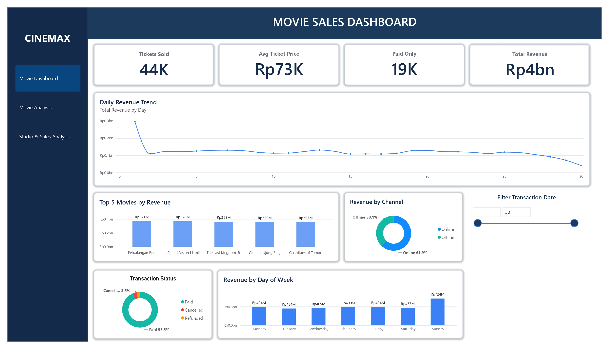
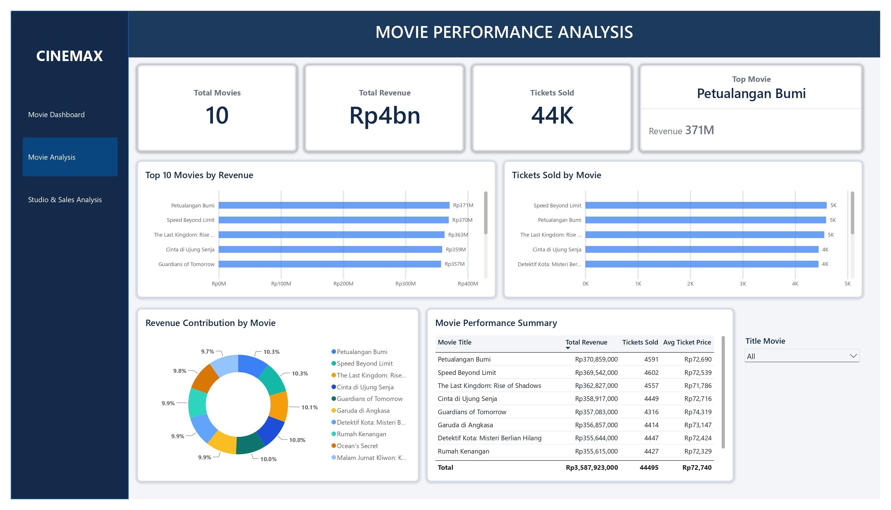
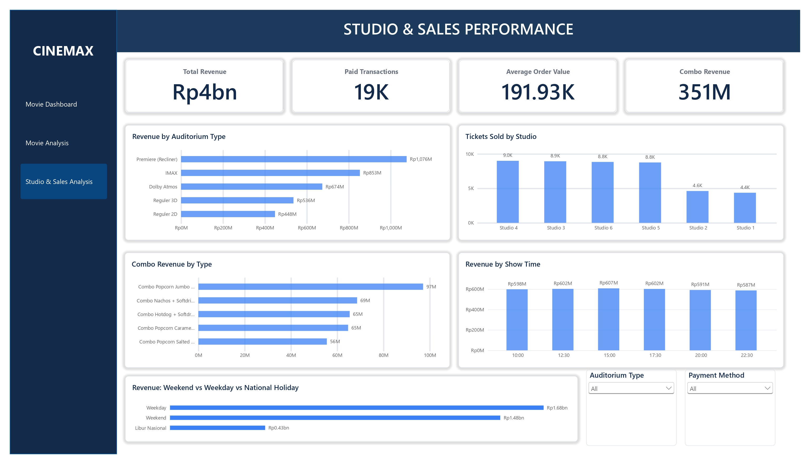

# Movie Sales Performance Dashboard

An interactive Power BI dashboard designed to analyze cinema sales performance using simulated transaction data.

## Project Overview

This project analyzes 20,000 simulated cinema transaction records from June 2025. The dashboard provides insights into revenue performance, ticket sales, movie popularity, transaction status, sales channels, auditorium performance, and combo sales.

## Tools & Technologies

- Microsoft Power BI
- Power Query
- DAX
- Microsoft Excel

## Dashboard Pages

### 1. Movie Dashboard (Overview)

Provides a summary of overall sales performance, including total revenue, tickets sold, average ticket price, daily revenue trends, and transaction status.

### 2. Movie Analysis

Analyzes movie performance through revenue rankings, ticket sales, revenue contribution, and movie performance comparisons.

### 3. Studio & Sales Analysis

Explores revenue and ticket sales across auditorium types, studios, showtimes, payment methods, and day categories.

## Dashboard Preview

### 1. Overview

### 2. Movie Analysis

### 3. Studio & Sales Analysis

## Key Business Insights

- Weekend generated higher average daily revenue than Weekday.
- The weighted average ticket price was higher during Weekend.
- Revenue differences were more closely associated with ticket price differences than ticket volume.

## Dataset Information

- Records: 20,000 transactions
- Period: June 1–30, 2025
- Data type: Simulated dataset

**Note:** This project uses simulated data for educational and portfolio purposes. It does not represent actual cinema company transactions.

## Project Files

The complete Power BI (.pbix) file is included in this repository.

## Author

Ziyad Muhammad Zain Soti
